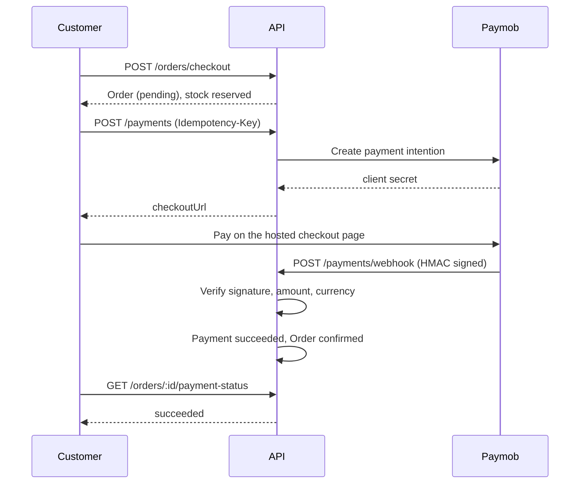

# E-commerce Store — NestJS API

A production-minded e-commerce backend built with **NestJS**, **TypeORM** and **PostgreSQL**. It covers the complete shopping journey — authentication, product catalog, cart, checkout, orders, and online payment — with a focus on clean architecture and data integrity under concurrency.

> The backend is feature-complete. The Next.js frontend is the next milestone.


---

## Highlights

- **Secure authentication.** JWT access tokens, refresh-token rotation with selector-based lookup, email verification, password reset, Google OAuth, and role-based access (Customer / Admin).
- **Full product catalog.** Categories, multiple image uploads per product, and a listing endpoint with pagination, search, filtering, and sorting.
- **Concurrency-safe cart and checkout.** Cart changes and checkout run inside transactions with pessimistic locks, and stock is decremented atomically, so the last item can never be sold twice.
- **Order lifecycle.** Price and address snapshots, validated status transitions, and stock restoration when a pending order is cancelled.
- **Safe online payments.** Paymob integration with idempotent payment creation, one active payment per order enforced by the database, and HMAC-verified webhooks. The gateway sits behind an abstract `PaymentProvider`, so it can be swapped easily.
- **Fail-fast configuration.** Environment variables are validated with Joi at startup.
- **Observability and docs.** Structured Pino logging, a health endpoint, and Swagger UI with Bearer auth.

## Tech Stack

| Area           | Technology                                     |
| -------------- | ---------------------------------------------- |
| Framework      | NestJS, TypeScript                             |
| Database       | PostgreSQL 16, TypeORM (migrations)            |
| Auth           | JWT, Passport (Google OAuth 2.0), bcrypt       |
| Payments       | Paymob (Intention API, test mode)              |
| Validation     | class-validator / class-transformer, Joi (env) |
| Logging        | Pino (`nestjs-pino`)                           |
| Scheduling     | `@nestjs/schedule` (token cleanup jobs)        |
| Email          | Nodemailer (SMTP)                              |
| Infrastructure | Docker, Docker Compose                         |
| API docs       | Swagger / OpenAPI                              |

## Features

**Customers**

- Register with email verification, login, refresh, logout, forgot / reset password, Google sign-in
- Browse products with pagination, search, filtering, and sorting
- Cart with stock validation
- Saved addresses
- Checkout, online payment, order history, and order cancellation (pending orders only)
- Payment status endpoint for the frontend to poll

**Admins**

- Product CRUD with multiple image uploads
- Category management
- Order listing with status filter and pagination
- Order status updates with validated transitions

## Architecture

```
src/
├── auth/         JWT, refresh tokens, Google OAuth, password reset
├── users/        User entity and roles
├── products/     Products and images
├── categories/   Categories
├── cart/         Cart and cart items
├── addresses/    Customer addresses
├── orders/       Checkout and order management
├── payments/     Payment layer
│   ├── interface/    Abstract PaymentProvider
│   ├── gateways/     Paymob implementation
│   └── entities/     Payment entity
├── storage/      Image storage (local disk, replaceable)
├── mail/         Email service and templates
├── common/       Guards, decorators, exception filter
├── config/       Env validation, TypeORM data source
├── health/       Health check
└── migrations/   Database migrations
```

### Payment flow (Paymob)



Key decisions:

- **The webhook is the source of truth.** The browser redirect is for UX only and never changes order state.
- **Stock is reserved at checkout**, not at payment, so a paid order can never be out of stock.
- **Failed attempts are only logged.** The customer can retry on the same checkout page, so the payment stays `pending`.
- **Double-charge protection at three levels:** the idempotency key, a partial unique index (`status IN ('pending','succeeded')` per order), and row locks while handling webhooks.

## Getting Started

### Prerequisites

- Docker and Docker Compose
- A [Paymob](https://paymob.com) account in test mode (integration ID, API keys, HMAC secret)
- A public tunnel (for example Cloudflare Tunnel) if you want to test payment webhooks locally

### 1. Clone and configure

```bash
git clone https://github.com/OsamaElshaer/ecommerce-store.git
cd ecommerce-store
cp .env.example .env.dev
```

Fill in `.env.dev`. See [`docs/backend/Env.md`](docs/backend/Env.md) for every variable. Never commit real keys; `.env.dev` is gitignored.

### 2. Start the stack

```bash
docker compose -f docker-compose.yml -f docker-compose-dev.yml up --build
```

The API runs on `http://localhost:3000` and PostgreSQL on port `5432`.

### 3. Run migrations

```bash
docker compose -f docker-compose.yml -f docker-compose-dev.yml exec app npm run migration:run
```

### 4. Explore the API

- Swagger UI: `http://localhost:3000/api/docs`
- Health check: `http://localhost:3000/health`

To test payments locally, Paymob must reach your webhook through a public tunnel. See the Payment Gateway section in [`docs/backend/Env.md`](docs/backend/Env.md#4-payment-gateway-paymob--test-mode).

## Scripts

| Command                                             | Description               |
| --------------------------------------------------- | ------------------------- |
| `npm run start:dev`                                 | Run in watch mode         |
| `npm run build`                                     | Build for production      |
| `npm run start:prod`                                | Run the production build  |
| `npm run lint`                                      | Lint and fix              |
| `npm run test`                                      | Unit tests                |
| `npm run test:e2e`                                  | End-to-end tests          |
| `npm run migration:generate -- src/migrations/Name` | Generate a migration      |
| `npm run migration:run`                             | Apply migrations          |
| `npm run migration:revert`                          | Revert the last migration |

## API Overview

Full reference: [`docs/backend/API.md`](docs/backend/API.md) (or Swagger UI).

| Area       | Endpoints                                                                                                                                             |
| ---------- | ----------------------------------------------------------------------------------------------------------------------------------------------------- |
| Auth       | `/auth/register`, `/auth/login`, `/auth/refresh`, `/auth/logout`, `/auth/verify-email`, `/auth/forgot-password`, `/auth/reset-password`, Google OAuth |
| Products   | `GET /products`, `GET /products/:id`, admin create / update / delete / images                                                                         |
| Categories | `GET /categories`, admin create / update / delete                                                                                                     |
| Cart       | `GET /cart`, `POST /cart/items`, `PATCH` and `DELETE /cart/items/:itemId`                                                                             |
| Addresses  | CRUD under `/addresses`                                                                                                                               |
| Orders     | `POST /orders/checkout`, `GET /orders`, `GET /orders/:id`, `PATCH /orders/:id/cancel`, admin status update                                            |
| Payments   | `POST /payments`, `POST /payments/webhook`, `GET /orders/:id/payment-status`                                                                          |

## Documentation

| Document                               | Description              |
| -------------------------------------- | ------------------------ |
| [PRD](docs/backend/PRD.md)             | Product requirements     |
| [ERD](docs/backend/ERD.md)             | Database design          |
| [API](docs/backend/API.md)             | Endpoint reference       |
| [Environment](docs/backend/Env.md)     | Environment variables    |
| [Task plan](docs/task%20plane.md)      | Sprint plan and progress |
| [User stories](docs/user%20stories.md) | User stories             |

## Roadmap

- [x] Authentication and authorization
- [x] Products, categories, cart, addresses
- [x] Checkout and order management
- [x] Paymob payments with verified webhooks
- [ ] Cancel unpaid orders automatically and restore stock
- [ ] Refunds and voids
- [ ] e2e test suite
- [ ] Admin statistics endpoint
- [ ] Next.js frontend

## Author

**Osama Elshaer** — Backend Developer (Node.js)

[GitHub](https://github.com/osamaelshaer) · [LinkedIn](https://linkedin.com/in/osamaelshaer)

## License

Released under the [MIT License](LICENSE).
