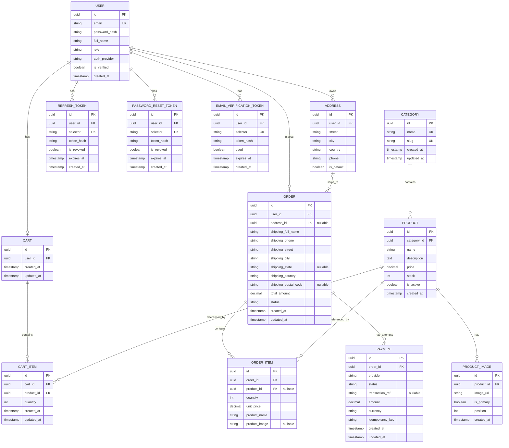

## 1. Diagram



---

## 2. Entities Overview

| Entity                     | Purpose                                                                          |
| -------------------------- | -------------------------------------------------------------------------------- |
| **User**                   | Customers and admins, differentiated by `role`.                                  |
| **Address**                | Shipping addresses linked to a user.                                             |
| **Category**               | Groups products into categories.                                                 |
| **Product**                | Store products belonging to a category.                                          |
| **ProductImage**           | Product images with a primary flag and display order.                            |
| **Cart**                   | One active cart per user.                                                        |
| **CartItem**               | Products inside a cart, with quantity.                                           |
| **Order**                  | A purchase created from the cart, including shipping details and total amount.   |
| **OrderItem**              | Order line items with historical product name and unit price snapshots.          |
| **Payment**                | A payment attempt associated with an order. An order can have multiple attempts. |
| **RefreshToken**           | Refresh-token sessions stored securely using a selector and hash.                |
| **PasswordResetToken**     | Temporary tokens used for password reset.                                        |
| **EmailVerificationToken** | Tokens used to verify email addresses.                                           |

---

## 3. Key Design Decisions

- **`Category` → `Product` is one-to-many.** Each product belongs to one category, while a category can contain many products.

- **`Product` stores `category_id` as a foreign key.** This keeps the initial product-category relationship simple.

- **`OrderItem` stores historical product information.** The product name and unit price are snapshots, so existing orders remain accurate when product details or prices change.

- **`Cart` is one-to-one with `User`.** A user has one active cart.

- **`CartItem` has a unique `(cart_id, product_id)` constraint.** Adding an existing product increases its quantity rather than creating a duplicate row.

- **Cart does not reserve stock.** Stock is checked again during checkout, and stock changes must be handled consistently by the checkout/payment flow.

- **`Order` → `Payment` is one-to-many.** An order can have multiple payment attempts. Each payment record represents one attempt and belongs to exactly one order. Failed attempts remain in history; retries create new payment records.

- **`Payment` stores only payment-specific information.** It does not duplicate `user_id` or shipping information. Those details can be reached through the related order.

- **`Payment.amount` and `Payment.currency` identify the amount and currency used for that attempt.** The expected purchase total is stored in `Order.total_amount`.

- **`idempotency_key` identifies a logical payment-creation request.** A database uniqueness constraint should prevent duplicate attempts for the same order and key. The application must also return or reuse the original result when a matching request is retried.

- **`Address` is a separate table.** The order stores a reference to the selected address and its own shipping snapshot. The address reference can be null if the address is later removed.

- **`ProductImage` is a separate table.** `is_primary` identifies the main image and `position` controls display order.

- **Deleting a Product cascades to its ProductImages** at the database level.

- **Deleting a Cart cascades to its CartItems.**

- **Deleting a Product currently cascades to its CartItems** through the `product_id` foreign key.

- **Order history should be preserved.** Order items can retain their snapshots even when a product is deleted. Payment attempts should not be deleted simply because a payment failed.

- **Physical product image files are not handled by database cascade.** The application handles file deletion separately from database records.

---

## 4. Relationships Summary

- One `User` → one `Cart`
- One `User` → many `Address`
- One `User` → many `Order`
- One `User` → many `RefreshToken`
- One `User` → many `PasswordResetToken`
- One `User` → many `EmailVerificationToken`
- One `Category` → many `Product`
- One `Product` → one `Category`
- One `Product` → many `ProductImage`
- One `Cart` → many `CartItem`
- One `CartItem` → one `Product`
- One `Order` → many `OrderItem`
- One `OrderItem` → one `Product`, optionally
- One `Order` → many `Payment` attempts
- One `Payment` → one `Order`
- One `Order` → zero or one `Address`

---

## 5. Important Constraints

```text
User
  └── Cart
       UNIQUE(user_id)

Cart
  └── CartItem
       UNIQUE(cart_id, product_id)

Category
  └── Product
       Product.category_id → Category.id

Product
  └── ProductImage
       ProductImage.product_id → Product.id
       ON DELETE CASCADE

Order
  └── Payment
       Payment.order_id → Order.id
       One order can have multiple payment attempts
       UNIQUE(order_id, idempotency_key)
```

---

## 6. Payment Flow

1. The customer starts checkout.
2. The backend creates the order and its order items.
3. The backend calculates the amount from the persisted order, not from a client-supplied amount.
4. A payment attempt is created with its provider, amount, currency, and idempotency key.
5. The payment provider returns its transaction reference or client-side payment data.
6. The provider sends a webhook.
7. The backend verifies the webhook signature and processes the event idempotently.
8. The payment attempt is updated to `succeeded` or `failed`.
9. The order status and stock are updated according to the checkout business rules, without applying the same successful event twice.
10. If payment fails and another attempt is allowed, a new payment record is created for the same order.
